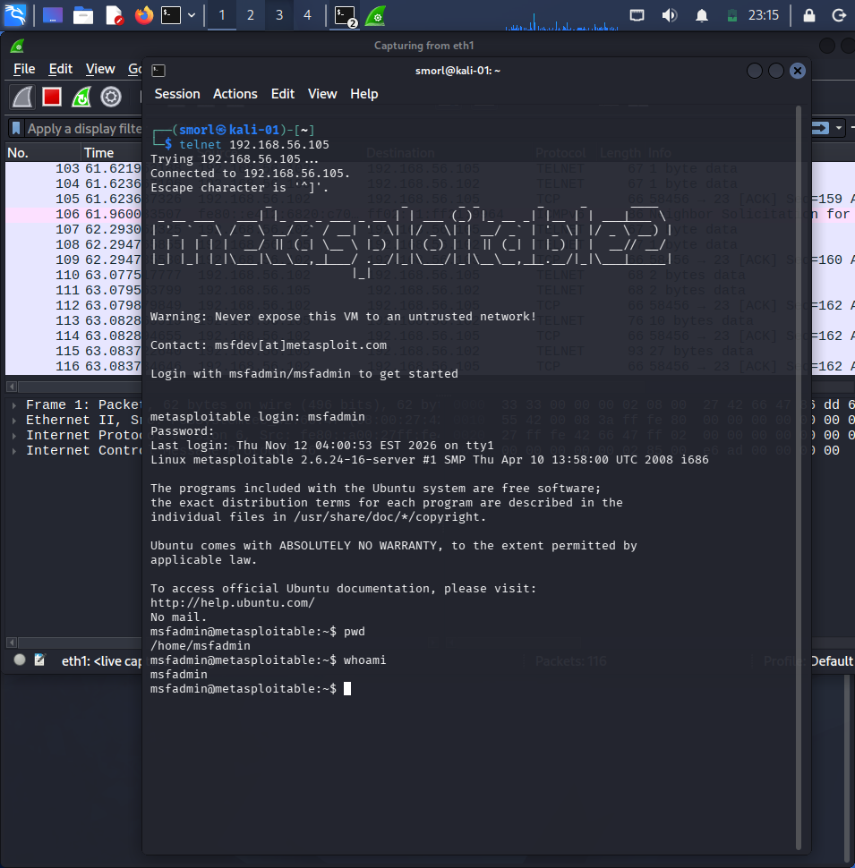
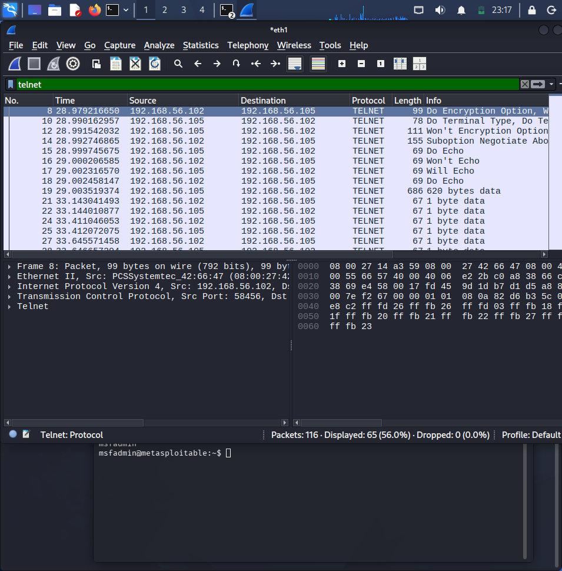
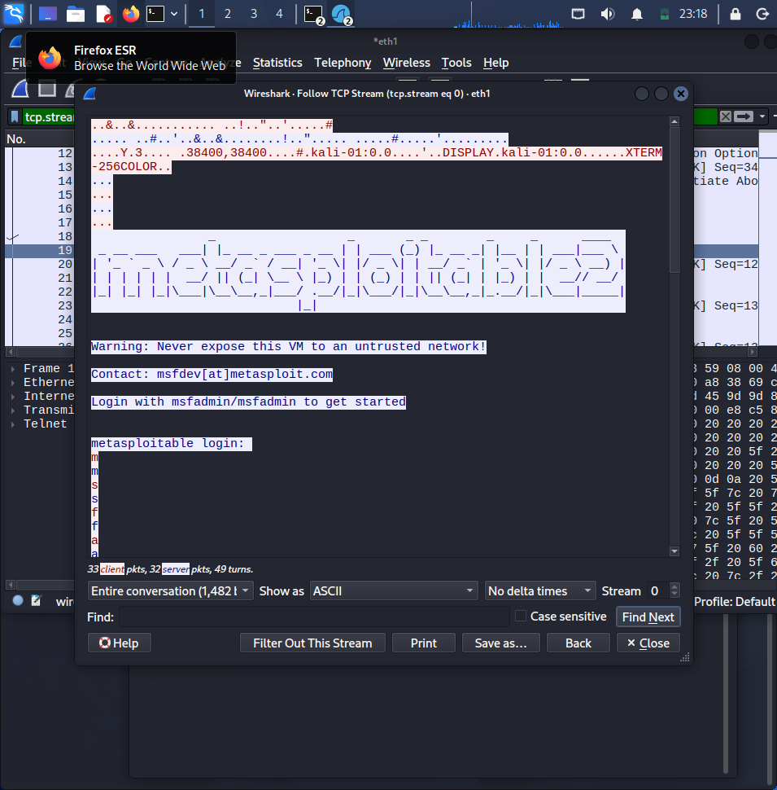
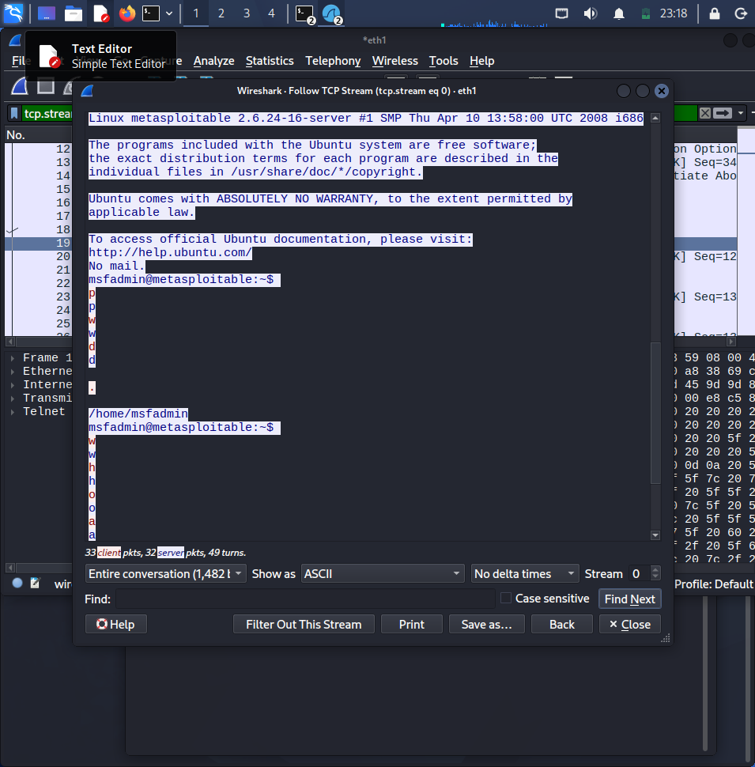

# Wireshark Telnet Traffic Analysis — Cleartext Session Capture

I captured and analyzed a live Telnet session between my Kali attacker machine and Metasploitable2. Unlike FTP, where credentials travel in a couple of distinct packets, Telnet sends every single keystroke as its own packet in real time — including the entire login, every command typed, and every character of output. This capture shows the full session reconstructed from raw traffic, with nothing encrypted at any point. Run entirely in an isolated lab, VirtualBox host-only network, no external access.

## Lab Setup

| Role | OS | IP Address |
|---|---|---|
| Observer / Client | Kali Linux | 192.168.56.102 |
| Target | Metasploitable2 | 192.168.56.105 |

## What I Did

### 1. Started a packet capture

I opened Wireshark on Kali and started capturing on `eth1`, the interface on the same subnet as the target.

```
sudo wireshark
```

### 2. Connected via Telnet and logged in

While the capture was running, I connected to Metasploitable's Telnet service from a separate terminal:

```
telnet 192.168.56.105
```

I logged in with `msfadmin` / `msfadmin`, ran a couple of commands (`pwd`, `whoami`), then exited.



### 3. Filtered the capture to Telnet traffic

Back in Wireshark, I applied a display filter to isolate just the Telnet protocol:

```
telnet
```

This immediately showed something distinctive: a long stream of tiny packets, most of them exactly **"1 byte data"**. Telnet doesn't batch what you type — every single keystroke is sent as its own packet the moment you press it. This is very different from FTP, where the whole username or password goes out in one packet.



### 4. Reconstructed the full session with Follow TCP Stream

Right-clicking a packet and choosing **Follow → TCP Stream** reassembles every individual keystroke packet back into a readable conversation — exactly as if I were watching the session happen live.

The reconstructed stream showed the full login banner, the warning message, and then my username being typed out letter by letter in plain, unencrypted text.



Scrolling further down the same stream showed my password entered the same way — no masking at the protocol level, since Telnet doesn't encrypt or obscure input in transit — followed by the commands I ran and their output.



## What This Shows

Telnet was designed in an era before network encryption was standard, and it still sends absolutely everything — the login prompt, username, password, every command, and every line of output — as plain, unencrypted text, one keystroke at a time. Anyone capturing traffic on the same network segment can reconstruct an entire interactive session, including credentials, with no special tools beyond Wireshark's built-in "Follow TCP Stream" feature.

This makes Telnet meaningfully worse than even plain HTTP or FTP in one respect: because every keystroke is its own packet, a passive observer doesn't just see the end result — they can watch the session unfold in close to real time, including any typos or corrections.

## How I'd Fix It

- Replace Telnet entirely with SSH, which encrypts the full session
- Disable the Telnet service on any system where it isn't strictly required
- If legacy systems require Telnet, isolate them on a segmented network with no path to untrusted traffic
- Monitor for any Telnet traffic on the network as a standing red flag in security audits — its presence alone indicates a cleartext protocol in active use

## Disclaimer

I captured this traffic exclusively within an isolated lab network, between machines I own and control, with Metasploitable2 — a VM intentionally built for legal security training. Capturing network traffic you don't have authorization to observe, on networks you don't own or have explicit permission to test, is illegal in most jurisdictions.
